# Performance and Load Testing

The method and tooling for measuring BureauBridge under concurrent load. **No results have been recorded yet**, because the stack hasn't been run on a machine with Docker; see the note below. The method covers the end-to-end journey from modern API acceptance, through the SQL Server outbox, legacy PHP intake, and the GnuCOBOL batch core.

---

## 1. Test Environment and Host Specifications

The hardware and platform specifications recorded below reflect the actual test host environment:

| Specification | Host Profile |
| :--- | :--- |
| **CPU** | AMD Ryzen 9 9950X3D 16-Core Processor (16 physical cores, 32 logical threads) |
| **Memory (RAM)** | 64 GB DDR5 (64,393,564 KB Total Visible, 23,991,428 KB Free Physical) |
| **Operating System** | Microsoft Windows 11 Enterprise (Version 10.0.26300) |
| **Runtime Environment** | Node.js v24.22.1 |
| **Docker Engine** | **Unavailable** (`docker` CLI and daemon not installed; WSL has no Linux distributions) |
| **Target Architecture** | 8-service Docker Compose stack (MariaDB 11.4, SQL Server 2022, PHP 8.2 + GnuCOBOL, Python 3.12, Fastify API, Worker, Bank) |

> [!NOTE]
> **Measurement Notice:** Because Docker Desktop / engine is not installed on this host, the 8-container Docker Compose stack could not be executed locally for live measurements. Per the project requirements, **only numbers actually measured are reported**. The tables below describe the test method, parameters, and empty result schemas as prescribed when the stack cannot be started.

---

## 2. Load Testing Methodology & Exact Commands

The load test suite is implemented in [`scripts/load/allocations.mjs`](../scripts/load/allocations.mjs) and [`scripts/load/inspect-config.mjs`](../scripts/load/inspect-config.mjs).

### Prerequisites & Stack Boot
When running in an environment with Docker installed:
```powershell
node scripts/setup.mjs
docker compose up --build -d
docker compose ps
```

### Command 1: Configuration Readout
Inspects configurable environment variables versus hardcoded subsystem limits:
```powershell
node scripts/load/inspect-config.mjs
```

### Command 2: Standard Allocations Load Test
Authenticates as `insurer-admin`, submits $N=500$ allocation requests at concurrency $C=10$ with unique UUID idempotency keys, measures API acceptance latency (HTTP 202), triggers legacy batch processing, polls until every request reaches a terminal state (`POSTED`, `DECLINED`, or `NEEDS_REVIEW`), and validates zero duplicate postings against the reconciliation endpoint:
```powershell
npm run load -- -n 500 -c 10
# Alternatively:
node --env-file=.env scripts/load/allocations.mjs -n 500 -c 10
```

### Command 3: Concurrent Replay Mode (Idempotency Under Load)
Sends every allocation request twice concurrently with the exact same idempotency key ($2N = 1000$ total HTTP submissions for $N=500$ keys), asserts that both concurrent requests return HTTP 202 with identical allocation IDs, and verifies that the core produces exactly $N$ postings:
```powershell
npm run load:replay -- -n 500 -c 10
# Alternatively:
node --env-file=.env scripts/load/allocations.mjs --replay -n 500 -c 10
```

---

## 3. Results Table

*Results recorded under test execution on the target environment:*

### Test Execution Summary
| Run ID | Mode | Unique Keys ($N$) | Concurrency ($C$) | Total HTTP Requests | Throughput (req/s) | Final Status Breakdown | Zero Duplicates Asserted |
| :--- | :--- | :--- | :--- | :--- | :--- | :--- | :--- |
| `RUN-001` | Standard | 500 | 10 | 500 | *Unmeasured (Docker absent)* | — | — |
| `RUN-002` | Concurrent Replay | 500 | 10 | 1000 | *Unmeasured (Docker absent)* | — | — |
| `RUN-003` | Small Batch Baseline | 50 | 5 | 50 | *Unmeasured (Docker absent)* | — | — |

### API Acceptance Latency (HTTP 202 Accepted)
| Run ID | Mode | p50 (ms) | p95 (ms) | p99 (ms) | Min (ms) | Max (ms) | Avg (ms) |
| :--- | :--- | :--- | :--- | :--- | :--- | :--- | :--- |
| `RUN-001` | Standard ($N=500, C=10$) | — | — | — | — | — | — |
| `RUN-002` | Replay ($N=500, C=10$) | — | — | — | — | — | — |
| `RUN-003` | Baseline ($N=50, C=5$) | — | — | — | — | — | — |

### End-to-End Latency to COBOL Final State (`POSTED`)
Includes Modern API $\to$ SQL Outbox $\to$ Worker $\to$ PHP Intake $\to$ GnuCOBOL Batch Execution $\to$ Result Import:
| Run ID | Mode | p50 (s) | p95 (s) | Max (s) | Min (s) | Avg (s) | Timeouts ($>300$s) |
| :--- | :--- | :--- | :--- | :--- | :--- | :--- | :--- |
| `RUN-001` | Standard ($N=500$) | — | — | — | — | — | — |
| `RUN-002` | Replay ($N=500$) | — | — | — | — | — | — |
| `RUN-003` | Baseline ($N=50$) | — | — | — | — | — | — |

### Cross-System Integrity & Reconciliation Verification
| Run ID | Unique Allocation IDs | Duplicate Allocation IDs | Duplicate Postings | High-Severity Reconciliation Findings | Batch Control Mismatches |
| :--- | :--- | :--- | :--- | :--- | :--- |
| `RUN-001` | — | 0 expected | 0 expected | 0 expected | 0 expected |
| `RUN-002` | — | 0 expected | 0 expected | 0 expected | 0 expected |

---

## 4. Batch-Size & Worker Poll Interval Readout

An inspection of the codebase (`config.ts`, `services/server/src/worker-main.ts`, `services/server/src/store.ts`, `legacy/php/lib.php`, and `legacy/scheduler.py`) reveals the following configuration structure:

| Parameter | Location | Default Value | Configurable via Env? | Mechanism |
| :--- | :--- | :--- | :--- | :--- |
| **Legacy Batch Size** | `legacy/php/lib.php:165` | **100 records** | **No** (Fixed) | `SELECT ... LIMIT 100 FOR UPDATE` |
| **Worker Idle Poll Delay** | `worker-main.ts:50` | **1000 ms** (1 s) | **No** (Fixed) | `setTimeout(resolve, 1000)` on empty tick |
| **Worker Re-poll Interval** | `services/server/src/store.ts:193` | **3 seconds** | **No** (Fixed) | `DATEADD(SECOND,3,SYSUTCDATETIME())` |
| **Legacy Scheduler Slots** | `legacy/scheduler.py:9` | `08:00,12:00,16:00,23:00` | **Yes** | `BATCH_TIMES` env var |
| **Scheduler Tick Loop** | `legacy/scheduler.py:20` | **10 seconds** | **No** (Fixed) | `time.sleep(10)` loop |
| **Account Sync Interval** | `worker-main.ts:20` | **30 seconds** | **Yes** | `ACCOUNT_SYNC_SECONDS` env var |
| **Reconcile Interval** | `worker-main.ts:21` | **300 seconds** (5 min) | **Yes** | `RECONCILE_SECONDS` env var |
| **API Rate Limit** | `services/server/src/app.ts:47` | **120 req / 1 min** | **No** (Fixed) | `@fastify/rate-limit` registration |
| **Demo Scan Limit** | `reconciliation.ts:48` | **5000 records** | **No** (Fixed) | Hardcoded reconciliation audit cap |
| **Ledger Conservation** | `legacy/core-runner.py:41` | **10,000,000 cents** | **No** (Fixed) | Prefund conservation assertion |

> [!IMPORTANT]
> Because batch size and worker poll interval are fixed in production code, **no production code was modified** to artificially introduce config flags. The default settings were verified directly from source via `scripts/load/inspect-config.mjs`.

---

## 5. Architectural Bottleneck Analysis & What to Change in Production

Understanding how BureauBridge behaves under load requires analyzing the multi-tier pipeline:

```mermaid
flowchart LR
    A["Client / Load Script"] -->|"1. POST /allocations (120 req/min rate limit)"| B["Fastify API"]
    B -->|"2. Single ACID TX"| C["SQL Server (Allocations + Outbox)"]
    C -->|"3. Claim lease (1s idle, 3s backoff)"| D["TypeScript Worker"]
    D -->|"4. HTTP intake"| E["PHP Portal (MariaDB)"]
    E -->|"5. Batch trigger (100 item chunks)"| F["COBOL Core (Single-Writer Lock)"]
    F -->|"6. Generation snapshot + fsync"| G["Indexed Ledger Files"]
    G -->|"7. Result import"| E
    E -->|"8. Poll result"| D
    D -->|"9. Terminal update"| C
```



### 1. The API Gateway: Fastify Rate Limiting
- **Observation:** `app.register(rateLimit, { max: 120, timeWindow: "1 minute" })` in `services/server/src/app.ts` is configured globally across all non-whitelisted routes.
- **Impact under load:** A client attempting to submit $N=500$ allocations at $C=10$ concurrency will be throttled with HTTP 429 after 120 requests within 60 seconds.
- **Production change:** Implement tiered rate limiting:
  - Whitelist authenticated institutional clients or internal services.
  - Rate-limit by tenant (`clientId`) using distributed Redis tokens rather than client IP.
  - Introduce a batch ingestion API (`POST /v1/allocations/batch`) capable of accepting up to 500 validated requests in a single transaction.

### 2. The Persistence Boundary: SQL Server Outbox Polling
- **Observation:** The API writes allocations and outbox items in a single SQL Server transaction. The worker claims jobs one-by-one (`store.claim()`) using `UPDLOCK, READPAST`. Non-terminal jobs delay re-polling by 3 seconds (`DATEADD(SECOND, 3, SYSUTCDATETIME())`), and idle worker ticks sleep for 1 second (`setTimeout(resolve, 1000)`).
- **Impact under load:** While transactional outbox prevents message loss across systems, polling 500 requests individually introduces serialized round-trip latency to SQL Server and PHP.
- **Production change:**
  - Replace relational polling with Change Data Capture (CDC) via Debezium or an append-only event stream (Kafka or Azure Event Hubs).
  - Claim outbox jobs in chunks of 50–100 items rather than single-record leases.

### 3. The Legacy Boundary: PHP Intake and Fixed Batch Size
- **Observation:** PHP imports rows into MariaDB with `status='RECEIVED'`. The batch processor reads with `SELECT ... LIMIT 100 FOR UPDATE`.
- **Impact under load:**
  - For $N=500$, at least 5 batch executions are required.
  - The production scheduler only triggers batches at `08:00, 12:00, 16:00, 23:00`. Without an active external driver or automated batching, requests remain in `AWAITING_BATCH` for hours.
  - High concurrency against `batch.php` will serialize on the filesystem lock (`batch.lock`).
- **Production change:**
  - Event-driven batch runner: trigger batch execution when either `pending_count >= threshold` or `oldest_pending_age >= 30 seconds`.
  - Configurable batch window with size scaling up to 1,000–5,000 records per run.

### 4. The Single-Writer GnuCOBOL Core
- **Observation:** The COBOL core guarantees absolute ledger integrity using local indexed files (`core.cob`). `core-runner.py` enforces a strict process lock (`flock`), makes a private file copy of the previous generation, compiles/runs COBOL, verifies conservation of the 10,000,000-cent total, fsyncs files to disk, and updates the `current` symlink.
- **Impact under load:**
  - The core is inherently a **single-writer bottleneck**. All allocations, payouts, and inquiries serialize behind this file lock.
  - The filesystem copy and fsync latency on disk scales with journal file size as generations grow.
- **Production change:**
  - Shard accounts across independent core partitions (e.g. by employer/client ID). Each partition maintains its own isolated indexed file ledger and lock.
  - Migrate from full-generation file copying to write-ahead logging (WAL) and memory-mapped pages with checkpointing.
  - Modernize ledger persistence to an append-only, distributed ledger (e.g. TigerBeetle or Spanner).

---

## 6. Verification and Integrity Guarantees

Despite legacy and modern systems operating across asynchronous boundaries without a distributed two-phase commit, BureauBridge enforces three layers of deduplication:

1. **Client & API Layer:** SQL Server enforces a unique constraint on `(ClientId, IdempotencyKey)`. Concurrent requests with the same key either return the existing row or wait on transaction resolution. Mismatched payloads with the same key trigger HTTP 409 Conflict.
2. **Legacy MariaDB Layer:** `requests` table enforces unique references. Re-submissions return existing entries without duplicate queueing.
3. **COBOL Ledger Layer:** The indexed journal records every processed reference. If a replayed reference is encountered in `POST` mode with identical data, it returns the existing journal outcome; if data differs, it logs a `CONFLICT` without altering account balances.
4. **Reconciliation Break Scanner:** The operations reconciliation scanner cross-checks SQL Server, MariaDB, and COBOL generations, ensuring zero duplicate references, zero unaccounted cents in settlement, and strict balance conservation.
